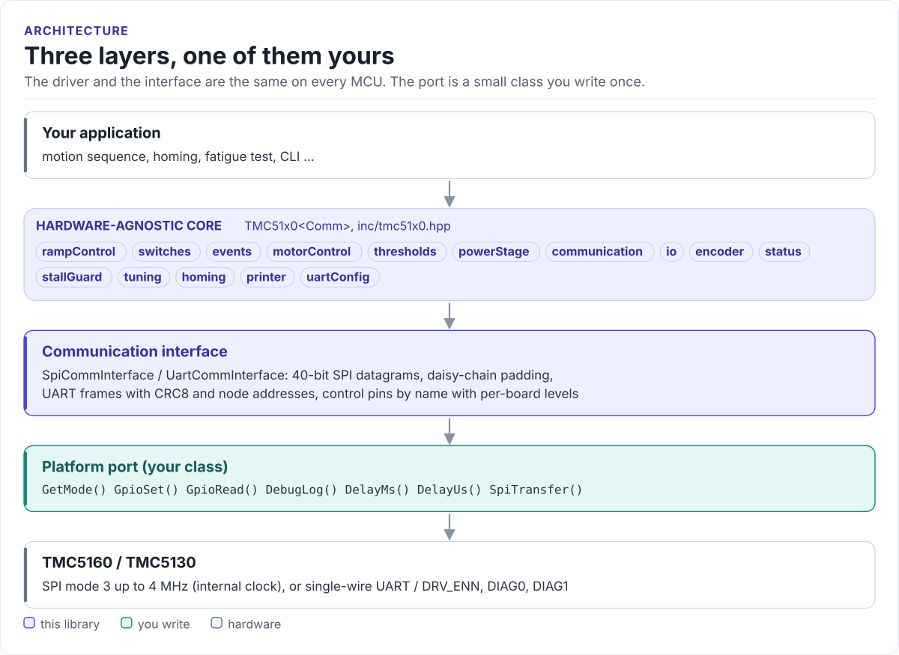

# TMC5160 Driver

A C++20 driver for the Analog Devices (Trinamic) TMC5160 and TMC5130 stepper motor controllers: motor current
from the motor's datasheet, internal ramps in degrees, millimetres or RPM, StallGuard2 homing and encoder
feedback, from any MCU with SPI or a UART.

[](https://github.com/hardfoc/hf-tmc5160-driver/actions/workflows/ci-host-tests.yml)
[](https://github.com/hardfoc/hf-tmc5160-driver/actions/workflows/esp32-examples-build-ci.yml)
[](https://hardfoc.github.io/hf-tmc5160-driver/)
[](LICENSE)

**Documentation: <https://hardfoc.github.io/hf-tmc5160-driver/>**

<!-- figure: driver-layers -->
<picture>
  <source media="(prefers-color-scheme: dark)" srcset="docs/diagrams/driver-layers.dark.svg">
  
</picture>
<!-- /figure -->

## In 30 seconds

Write a small port class for your MCU (SPI transfer, the DRV_ENN pin, a delay;
[Porting](https://hardfoc.github.io/hf-tmc5160-driver/latest/porting/)), then:

<!-- generated: quickstart-code -->
```cpp
#include "tmc51x0.hpp"

int move_half_a_turn(MySpi& spi) {
  tmc51x0::TMC51x0<MySpi> driver(spi);

  tmc51x0::DriverConfig cfg{};                     // 1. motor and board
  cfg.motor_spec.rated_current_ma = 1500;          //    motor datasheet, RMS
  cfg.motor_spec.sense_resistor_mohm = 50;         //    R_SENSE on your board
  cfg.motor_spec.supply_voltage_mv = 24000;        //    VS
  if (!driver.Initialize(cfg)) {
    return -1;                                     // wiring, power or SPI mode
  }

  driver.rampControl.SetMaxSpeed(60.0f, tmc51x0::Unit::RPM);          // 2. ramp
  driver.rampControl.SetAcceleration(2.0f, tmc51x0::Unit::RevPerSec);  //    rev/s²
  driver.motorControl.Enable();                                        // 3. DRV_ENN low
  driver.rampControl.SetTargetPosition(180.0f, tmc51x0::Unit::Deg);    // 4. move

  for (;;) {                                       // 5. wait for position_reached
    auto reached = driver.rampControl.IsTargetReached();
    if (!reached) return -2;
    if (reached.Value()) return 0;
  }
}
```
<!-- /generated -->

## What it does

- Computes `GLOBAL_SCALER`, `IRUN` and `IHOLD` from the motor's rated current, the sense resistor and the supply.
- Runs the chip's ramp generator in degrees, steps, millimetres, RPM or rev/s, with gearbox, lead screw and belt
  ratios.
- Exposes the chip as subsystems: `rampControl`, `motorControl`, `thresholds`, `stallGuard`, `tuning`, `homing`,
  `encoder`, `status` and more.
- Tunes the StallGuard2 threshold and finds the ends of travel without switches.
- Talks SPI (with daisy chains) or single-wire UART (with node addresses and CRC8); detects TMC5130 and TMC5160.
- No exceptions, no RTOS, no virtual calls (the port is a CRTP class); every call returns `Result<T>`.

## Install

```bash
git submodule add https://github.com/hardfoc/hf-tmc5160-driver.git external/hf-tmc5160-driver
```

```cmake
add_subdirectory(external/hf-tmc5160-driver)
target_link_libraries(my_app PRIVATE hf_tmc51x0)
```

ESP-IDF: use the component wrapper in [`examples/esp32/components/hf_tmc51x0`](examples/esp32/components/hf_tmc51x0/CMakeLists.txt).
Details: [Installation](https://hardfoc.github.io/hf-tmc5160-driver/latest/installation/).

## Documentation

| | |
| --- | --- |
| [Quickstart](https://hardfoc.github.io/hf-tmc5160-driver/latest/quickstart/) | Wire it, write the port, move a motor |
| [Hardware](https://hardfoc.github.io/hf-tmc5160-driver/latest/hardware/) | Pins, mode straps, bus settings, power |
| [API guide](https://hardfoc.github.io/hf-tmc5160-driver/latest/api-guide/) | Initialise, move, read, detect stalls, handle faults |
| [StallGuard and homing](https://hardfoc.github.io/hf-tmc5160-driver/latest/stallguard-and-homing/) | Sensorless load measurement, tuning, bounds finding |
| [Examples](https://hardfoc.github.io/hf-tmc5160-driver/latest/examples/) | ESP32 applications |
| [API reference](https://hardfoc.github.io/hf-tmc5160-driver/latest/api/) | Doxygen, every class and member |

The pages are in [`docs/`](docs/index.md); the datasheet is in [`docs/datasheet/`](docs/datasheet/).

## Tests

```bash
cmake -S . -B build-host -DHF_TMC51X0_BUILD_TESTS=ON && cmake --build build-host && ctest --test-dir build-host
```

The host tests run the driver against a model of the chip; the code on the documentation site is compiled by the
same build.

## License

GPL-3.0. See [LICENSE](LICENSE).
