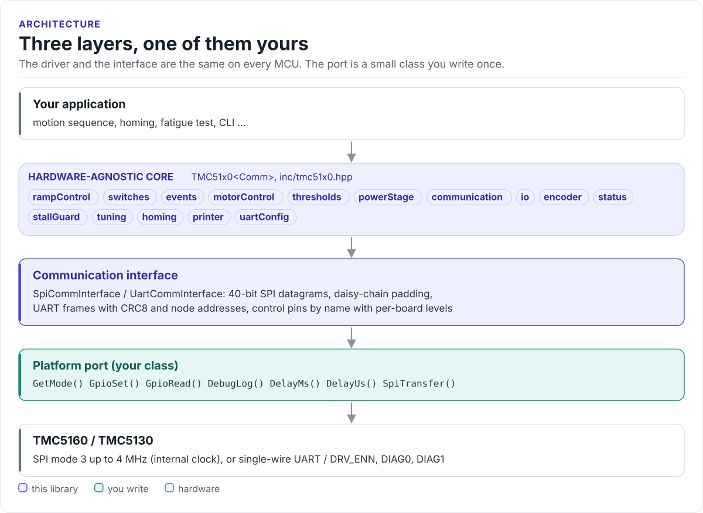
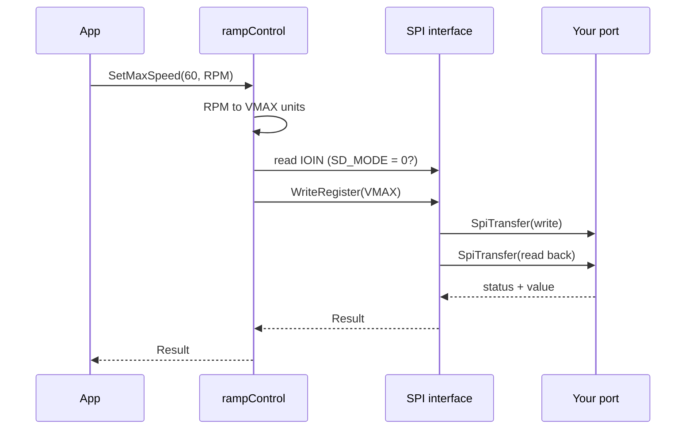

# Architecture

How the driver is put together: three layers, what each owns, and how one call reaches the chip.

<!-- figure: driver-layers -->
<picture>
  <source media="(prefers-color-scheme: dark)" srcset="diagrams/driver-layers.dark.svg">
  
</picture>
<!-- /figure -->

## The three layers

| Layer | Where | Depends on | You change it when |
| --- | --- | --- | --- |
| **Hardware-agnostic core**: `TMC51x0<Comm>` and its subsystems | [`inc/tmc51x0.hpp`](../inc/tmc51x0.hpp), [`src/tmc51x0.ipp`](../src/tmc51x0.ipp) | The interface's register access only | Never, for a new board |
| **Communication interface**: `SpiCommInterface`, `UartCommInterface` | [`inc/tmc51x0_comm_interface.hpp`](../inc/tmc51x0_comm_interface.hpp) | The methods of your port | Never |
| **Platform port**: your class | Your project | Your SDK | Once per MCU or board ([Porting](porting.md)) |

Everything above the port is the same on ESP32, STM32, a Linux host or the unit-test model. That is how the
[host tests](testing.md) run the real driver code without hardware.

## The subsystems

| Member | Owns | Registers |
| --- | --- | --- |
| `rampControl` | Ramp mode, targets, speeds, accelerations, position readback | `RAMPMODE`, `XACTUAL`, `XTARGET`, `VMAX`, `AMAX`, `DMAX`, `A1`, `D1`, `VSTART`, `VSTOP` |
| `motorControl` | Enable, currents, chopper, StealthChop, CoolStep, DcStep, microstep table | `IHOLD_IRUN`, `GLOBAL_SCALER`, `CHOPCONF`, `PWMCONF`, `COOLCONF`, `MSLUT*` |
| `thresholds` | Speeds at which the chip changes chopper mode | `TPWMTHRS`, `TCOOLTHRS`, `THIGH`, `VDCMIN` |
| `powerStage` | Gate drive and short protection (TMC5160 only) | `DRV_CONF`, `SHORT_CONF` |
| `switches`, `events` | Reference switches, latching, position compare, ramp events | `SW_MODE`, `XLATCH`, `X_COMPARE`, `RAMP_STAT` |
| `encoder` | ABN encoder scaling, deviation, N channel | `ENCMODE`, `X_ENC`, `ENC_CONST`, `ENC_STATUS`, `ENC_DEVIATION` |
| `stallGuard`, `tuning`, `homing` | Stall detection, SGT tuning, bounds finding and homing | `COOLCONF.sgt`, `DRV_STATUS`, `SW_MODE.sg_stop` |
| `status`, `io` | Faults, temperatures, load, input pins, chip version, OTP | `GSTAT`, `DRV_STATUS`, `IOIN`, `PWM_SCALE`, `LOST_STEPS` |
| `communication`, `uartConfig` | Daisy-chain position, UART node address, clock | `NODECONF` |
| `printer` | Decoded register dumps for bring-up | any |

## How one call reaches the chip

The RPM conversion uses fCLK, steps per revolution and the microstep resolution. Every register access
goes through the core's chain position or node address to the interface.

## Design choices

**CRTP, not virtual functions.** The interface is a template parameter. The compiler sees your port's methods
directly and inlines them; the driver has no vtable and needs no RTTI. The cost is that the driver type names the
port: `TMC51x0<MySpi>`.

**`Result<T>` everywhere.** Every call that touches the bus returns `Result<T>`: an `ErrorCode` and a value. It
converts to `bool`, offers `Value()`, `ValueOr()` and `ErrorMessage()`, and supports structured bindings. No
exceptions, no output parameters for the common cases.

**Shadow copies of write-only registers.** Most TMC5160 registers are write-only (`IHOLD_IRUN`, `GLOBAL_SCALER`,
`VMAX`, ...). The driver keeps the last value it wrote, so it can change one field of a register and report the
current settings.

**Units in, register values out.** Positions, speeds and accelerations take a `Unit`; the conversion uses the
clock frequency, steps per revolution, microstep resolution and the mechanical system from `DriverConfig`
([Motion and units](motion-and-units.md)).

**One driver object per chip.** Several chips share one interface object: each driver carries its daisy-chain
position (SPI) or node address (UART) and passes it with every access ([Multi-chip](multi-chip.md)).

## Source map

| Path | Contents |
| --- | --- |
| `inc/tmc51x0.hpp` | `TMC51x0<Comm>` and its subsystems |
| `src/tmc51x0.ipp` | Template implementation, included by the header |
| `inc/tmc51x0_comm_interface.hpp` | `CommInterface`, `SpiCommInterface`, `UartCommInterface`, datagrams, control pins |
| `inc/tmc51x0_types.hpp` | `DriverConfig` and every configuration struct and enum |
| `inc/tmc51x0_result.hpp` | `Result<T>` and `ErrorCode` |
| `inc/registers/` | Register addresses and bit-field unions |
| `inc/features/` | Unit conversion, current calculation, `ConfigBuilder`, daisy-chain and multi-node helpers |
| `tests/` | Host unit tests and the compiled documentation snippets |
| `examples/esp32/` | ESP-IDF applications |
