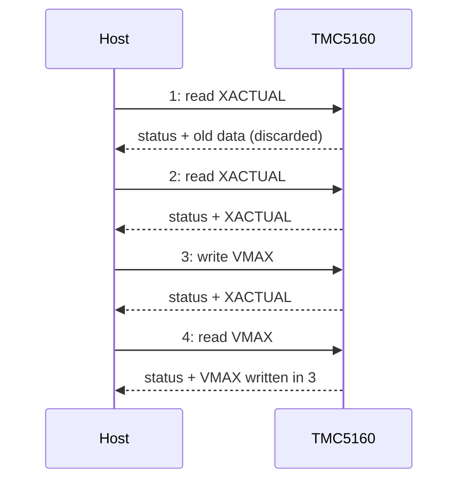

# Hardware

What to connect between your MCU and a TMC5160, with which bus settings and supplies, and the board-level traps to
avoid.

All values here come from the [TMC5160 / TMC5160A datasheet](datasheet/tmc5160a-datasheet-rev1.18.pdf)
(Rev. 1.18, 2023-03-01). Pin numbers are given for the eTQFP48 package, with the QFN56 number in brackets. The
TMC5130 has the same digital interface; check its own datasheet for its pinout and supply range
([TMC5130](tmc5130.md)).

## Mode straps

SPI_MODE and SD_MODE select the interface and the motion source. Tie them to GND or VCC_IO. Treat them as
straps: hard-wire them, or change them only while the chip is unpowered.

| SPI_MODE (22) | SD_MODE (21) | Mode | Use with this driver |
| --- | --- | --- | --- |
| high | low | SPI, internal ramp generator | Yes: the full API |
| high | high | SPI, external STEP/DIR | Yes: configuration and diagnostics; motion calls return `INVALID_STATE` |
| low | low | Single-wire UART, internal ramp generator | Yes: the full API over `UartCommInterface` |
| low | high | Standalone STEP/DIR, configured by the CFG pins | No serial interface |

SPI_MODE has an internal pull-down: left open it selects UART or standalone mode, not SPI. The driver reads
SD_MODE back from `IOIN` and refuses ramp, homing, tuning and encoder calls when the chip runs from STEP/DIR.

## SPI pins

| Signal | TMC5160 pin | Direction (chip) | Notes |
| --- | --- | --- | --- |
| CSN_CFG3 | 13 (14) | in | Active low; hold it low for the whole datagram |
| SCK_CFG2 | 14 (15) | in | |
| SDI_CFG1 | 15 (16) | in | MOSI |
| SDO_CFG0 | 16 (17) | out, tristate | MISO; released while CSN is high, so the bus can be shared |

## UART pins

| Signal | TMC5160 pin | Direction (chip) | Notes |
| --- | --- | --- | --- |
| DIAG1_SWP | 27 (28) | in / out | Single-wire data. Join the MCU's TX and RX to it |
| DIAG0_SWN | 26 (27) | in / out | Inverted data for a differential (RS485-like) bus. In a 3.3 V single-wire design tie it to half the I/O voltage; with 5 V I/O it can stay open |
| SDI_CFG1 (NAI) | 15 (16) | in | Next-address input for sequential addressing ([Multi-chip](multi-chip.md)) |
| SDO_CFG0 (NAO) | 16 (17) | out | Next-address output to the following chip's NAI (high after reset) |

## Control and status pins

The driver addresses these by name (`tmc51x0::TMC51x0CtrlPin`) and by state (`GpioSignal::ACTIVE` /
`INACTIVE`); your port turns a state into a level ([Porting](porting.md#control-pins)).

| Pin | TMC5160 pin | What it does | Driver use |
| --- | --- | --- | --- |
| DRV_ENN (in) | 28 (29) | High switches the power stage off (outputs floating) | `motorControl.Enable()` / `Disable()` drive `EN` |
| CLK (in) | 12 (13) | GND for the internal clock, or an external clock | `SetClkFreq()` on your port (optional) |
| REFL_STEP, REFR_DIR (in) | 17 (18), 18 (19) | Left / right reference switch, or STEP / DIR when SD_MODE is high | `switches`, `homing` |
| ENCA, ENCB, ENCN (in) | 24, 23, 25 (24, 23, 26) | ABN encoder (SD_MODE low), or DcStep pins | `encoder` |
| DIAG0, DIAG1 (out) | 26 (27), 27 (28) | Interrupt / stall / position-compare outputs in SPI mode | Optional: read through `GpioRead()` |

ENCA and ENCB have internal pull-downs. With SD_MODE low, pull ENCN to GND or VCC_IO when no encoder is fitted.
In open-drain mode the DIAG outputs need an external pull-up of 47 kΩ or less.

## Bus settings

| Setting | SPI | UART |
| --- | --- | --- |
| Mode / format | Mode 3 (CPOL = 1, CPHA = 1), MSB first | 8N1, single wire, half duplex |
| Speed | Up to 4 MHz on the internal clock; up to 8 MHz with a 16 MHz external clock | 9000 baud minimum, up to fCLK/16 (750 kbaud at 12 MHz); the chip detects the baud rate from each frame |
| Frame | 40 bits: address byte (bit 7 = write) and 32 data bits | Write: 8 bytes. Read: 4-byte request, 8-byte reply. Sync nibble and CRC8 |
| Chip select | Low for the whole datagram; high time tCSH > 2 tCLK + 10 ns | n/a |
| Reply | The data of a read arrives with the **next** datagram | After SENDDELAY bit times (default 8; at least 2 × 8 with several nodes) |
| Timing filter | SPI inputs and DRV_ENN ignore pulses shorter than 20 ns | A pause of more than 63 bit times resets the frame |

The datasheet limits SCK to half the system clock and asks for a further 10 % margin on the internal oscillator,
which gives the 4 MHz above. The ESP32 examples run SPI at 500 kHz.

Every reply starts with `SPI_STATUS`: reset, driver error, StallGuard, standstill, velocity and position reached,
and the two stop switches. [Communication protocols](protocols.md) covers the datagrams in detail.

## Power

| Supply | Range | Notes |
| --- | --- | --- |
| VS (motor bridges, charge pump) | 10 V to 55 V | Full specification. Down to 8 V with short-to-GND protection inactive. 60 V absolute maximum, including ringing |
| VSA (5 V and 11.5 V regulators) | 10 V to 50 V | Normally tied to VS |
| VCC_IO (digital I/O) | 3.0 V to 5.25 V | Your MCU's I/O voltage; sets the level of every digital pin |
| VCC (digital core) | 5 V | From the chip's own 5VOUT through 2.2 Ω to 3.3 Ω |

Connect the MCU ground to the TMC5160 ground plane. Supply current with the driver disabled is 18 mA typical
at 24 V and 12 MHz. The internal clock is factory-calibrated to 12 MHz ± 0.5 MHz at 50 °C; an external clock may
run from 4 MHz to 18 MHz (10 MHz to 16 MHz recommended).

!!! danger "Size the supply path for the motor, not the chip"
    The bridge switches the full coil current from VS. Put low-ESR bulk capacitance close to the MOSFETs, keep the
    sense-resistor ground loop short, and keep the motor connected while VS is on: unplugging a running motor
    produces a voltage spike that can exceed the 60 V rating.

## Sense resistor and current range

Two sense resistors set the coil current range. The full-scale RMS current is

IRMS,max = VFS / RSENSE / √2, with VFS = 325 mV typical,

so 50 mΩ gives about 4.6 A RMS and 33 mΩ about 7.0 A RMS (derived from the formula, not measured). The driver
scales the current down from there with `GLOBAL_SCALER` (32 to 256) and `IRUN` / `IHOLD` (0 to 31); give it
`sense_resistor_mohm` and it does the arithmetic ([Current and chopper](current-and-chopper.md)).

## Evaluation boards

| Board | What it is |
| --- | --- |
| TMC5160-EVAL | Evaluation board for the Trinamic Landungsbrücke / Eselsbrücke system (TMC5160-EVAL-KIT is the full kit) |
| TMC5160-BOB | Breakout board with the TMC5160 |

The [ESP32 examples](examples.md) run on an ESP32-C6. Their pin assignment:

| Signal | ESP32-C6 GPIO |
| --- | --- |
| SCK, MOSI, MISO, CS | 5, 6, 2, 18 |
| DRV_ENN | 11 |
| CLK | 10 |
| DIAG0, DIAG1 | 23, 15 |
| SPI_MODE, SD_MODE (when driven) | 0, 1 |

It lives in [`esp32_tmc51x0_test_config.hpp`](../examples/esp32/main/test_config/esp32_tmc51x0_test_config.hpp).

## Reference documents

| Document | What it is for |
| --- | --- |
| [TMC5160 / TMC5160A datasheet](datasheet/tmc5160a-datasheet-rev1.18.pdf) | Pins, registers, electrical limits, chopper and StallGuard tuning |
| [TMC5130 product page](https://www.analog.com/en/products/tmc5130.html) | The TMC5130 datasheet |
