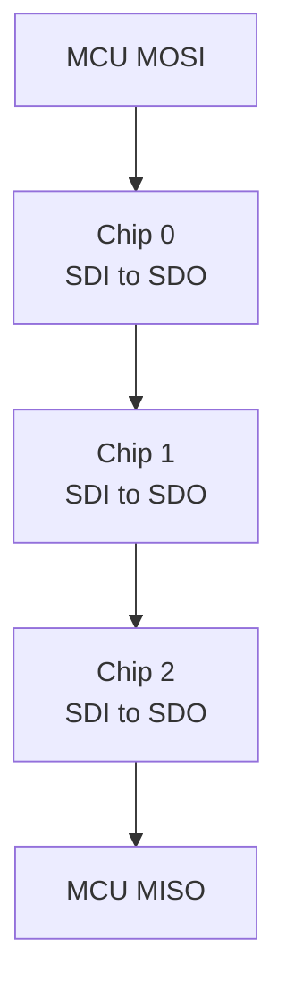

# Multi-chip

How to drive several TMC5160s from one MCU: an SPI daisy chain on one chip select, or several nodes on one
single-wire UART.

Each chip gets its own `TMC51x0` object; all of them share one port object. The driver passes each chip's
position (SPI) or node address (UART) with every register access.

## SPI daisy chain

The chips share CSN, SCK and MOSI. Data shifts through them: the MCU's MOSI feeds chip 0's SDI, each chip's SDO
feeds the next chip's SDI, and the last chip's SDO returns to the MCU's MISO.



Every chip has a 40-bit shift register. While CSN is low, bits clocked in on SDI come out on SDO 40 clocks later;
when CSN rises, each chip takes the 40 bits it holds as its command. To reach chip k of n, the driver sends the
command followed by padding, max(k + 1, n − k) × 5 bytes in one transfer, and takes chip k's reply from byte
(n − k − 1) × 5.

```cpp
--8<-- "tests/docs/multi_chip.cpp:spi-chain"
```

| Rule | Detail |
| --- | --- |
| Tell the interface the chain length | `SetDaisyChainLength(n)` on the port before the first access. The interface also measures the chain on first use and logs a mismatch; it then uses the measured length |
| Position 0 is next to MOSI | The chip whose SDI is on the MCU's MOSI |
| One transfer per access | Your `SpiTransfer()` must keep CSN low for the whole buffer: 5 × n bytes or more |
| Chain limit | `TMC51X0_SPI_MAX_CHAIN_DEVICES`, 8 by default; raise it at compile time for longer chains |

Chips on separate chip selects are simpler: give each its own port object (or one port that selects the CS line)
and leave the chain length at 1.

## UART nodes

In UART mode (SPI_MODE and SD_MODE low) the chips share the single-wire bus and each answers to its own 8-bit
node address. A chip's address is `NODECONF.NODEADDR`, plus one while its NAI pin is high.

Wire NAI of the first chip to GND and each chip's NAO to the next chip's NAI. After power-up every `NODEADDR` is 0,
so the first chip answers at 0 and all others at 1. Then, one chip at a time:

<div class="hf-steps" markdown>

1. Write the chip's final address into `NODECONF` through address 0.
2. Drive its NAO low (`OUTPUT` bit 0 = 0). The next chip's NAI goes low and it now answers at 0.
3. Repeat for the next chip.

</div>

```cpp
--8<-- "tests/docs/multi_chip.cpp:uart-nodes"
```

| Rule | Detail |
| --- | --- |
| Count addresses down | Chips not yet programmed answer at 1, so give programmed chips high addresses, as the datasheet does (254, 253, ...) |
| Addresses up to 127 with this driver | The UART interface masks the node address to 7 bits on the wire, although `NODEADDR` holds 0 to 253 |
| SENDDELAY of 2 or more | With several nodes a shorter reply delay makes the other nodes see a transmission error |
| Keep `DriverConfig::uart_config` at its defaults here | A non-zero `node_address` or `send_delay` in it makes `Initialize()` write `NODECONF` again |
| Power cycles reset `NODECONF` | Program the addresses after every power-up |

For two chips, tying one NAI low and the other high gives addresses 0 and 1 without any programming.

!!! note "Helper classes"
    `inc/features/tmc51x0_daisy_chain.hpp` (`TMC51x0DaisyChain`) and `inc/features/tmc51x0_multi_node.hpp`
    (`TMC51x0MultiNode`) wrap these procedures, but they do not compile today (among other errors, their
    constructors pass the wrong arguments to `TMC51x0`). Use the individual driver objects shown above.

Next: [Communication protocols](protocols.md).
