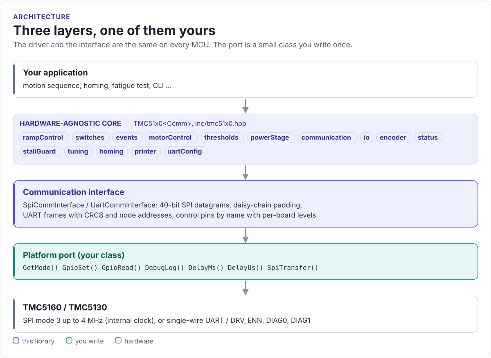

# Porting

Run the driver on a new MCU by writing one class: the communication interface for SPI or UART.

The driver never calls your SDK directly. It calls a few methods on a class you derive from
`tmc51x0::SpiCommInterface<Self>` or `tmc51x0::UartCommInterface<Self>` (in
[`inc/tmc51x0_comm_interface.hpp`](../inc/tmc51x0_comm_interface.hpp)). The base classes use CRTP: the calls are
resolved at compile time, so there are no virtual functions and no vtable.

<!-- figure: driver-layers -->
<picture>
  <source media="(prefers-color-scheme: dark)" srcset="diagrams/driver-layers.dark.svg">
  
</picture>
<!-- /figure -->

## What you implement

| Method | SPI | UART | Contract |
| --- | :---: | :---: | --- |
| `GetMode()` | yes | yes | Return `CommMode::SPI` or `CommMode::UART` |
| `SpiTransfer(tx, rx, length)` | yes | | One full-duplex transfer of `length` bytes with CSN low throughout. `length` is a multiple of 5 |
| `UartSend(data, length)` | | yes | Send one frame (8 bytes for a write, 4 for a read request) and remove the echo |
| `UartReceive(data, length)` | | yes | Return success only when all `length` bytes (an 8-byte reply) arrived |
| `SetNaiPin(active)`, `GetNaoPin()` | | yes | Drive NAI / read NAO for sequential addressing; return `UNSUPPORTED` when not wired |
| `GpioSet(pin, signal)` | yes | yes | Drive a control pin (at least `EN`, DRV_ENN) to `ACTIVE` / `INACTIVE` |
| `GpioRead(pin)` | yes | yes | Read a pin as `ACTIVE` / `INACTIVE`; return `UNSUPPORTED` / `INVALID_VALUE` for pins you do not have |
| `DelayMs(ms)`, `DelayUs(us)` | yes | yes | Block for at least that long |
| `DebugLog(level, tag, format, va_list)` | yes | yes | Print one line (0 = error ... 4 = verbose), or do nothing |
| `SetClkFreq(hz)` | optional | optional | Drive the CLK pin: 0 = tie low for the internal clock. Default: `UNSUPPORTED` |
| `SetPowerEnabled(on)` | optional | optional | Switch the chip's supply, for `HardReset()` by power cycle. Default: `UNSUPPORTED` |

All methods are `noexcept` and return `tmc51x0::Result<...>` where the table shows a result.

## SPI port

```cpp title="my_spi.hpp"
--8<-- "tests/docs/my_spi.hpp:port"
```

Rules the transfer must follow:

- **SPI mode 3**, MSB first, up to 4 MHz on the chip's internal clock (8 MHz with a 16 MHz external clock).
- **One transaction per call.** CSN goes low before the first byte and high after the last. In a daisy chain the
  buffer covers every chip; never split it.
- **Full duplex, same length.** Fill `rx` with exactly `length` bytes.
- **Return an error only for a bus failure.** Status bits and register contents are the driver's job.
- **Serialise access.** The interface uses per-object scratch buffers: one transfer at a time per port object.

## UART port

```cpp title="my_uart.hpp"
--8<-- "tests/docs/my_uart.hpp:port"
```

On a single wire the MCU's TX and RX are joined, so every frame you send comes back on RX. The driver expects
`UartReceive()` to return the chip's reply only: flush the receive buffer after sending (as the ESP32 port does),
or read and discard `length` echo bytes. Choose a baud rate between 9000 and f<sub>CLK</sub>/16; the chip detects
it from each frame's sync nibble. Allow for the reply delay (`SENDDELAY`, 8 bit times by default) in the receive
timeout.

## Control pins

`GpioSet()` and `GpioRead()` receive a pin name (`TMC51x0CtrlPin`) and a state (`GpioSignal`). Your port turns a
state into a level. `tmc51x0::PinActiveLevels` holds the datasheet levels; `GetActiveLevel(pin)` returns the level
of the active state:

| Pin | Datasheet active level | Meaning of `ACTIVE` |
| --- | --- | --- |
| `EN` (DRV_ENN) | low | Power stage enabled |
| `REFL_STEP`, `REFR_DIR` as switches | low (configurable in `SW_MODE`) | Switch pressed |
| `STEP`, `DIR`, `DCEN`, `DCIN` | high | |
| `DIAG0`, `DIAG1` | high (push-pull default) | Event signalled |
| `SPI_MODE`, `SD_MODE` | high | SPI interface, external STEP/DIR |

The driver drives `EN` in `Enable()` / `Disable()`, and `SPI_MODE` / `SD_MODE` only in
`io.SetOperatingMode()` / `GetOperatingMode()`, for boards that wire the straps to GPIOs. The other pins exist
for applications that want them; a port may return `UNSUPPORTED` for pins it does not wire. Change a level with
`PinActiveLevels::SetActiveLevel()` when your board inverts a signal.

## Reference implementation

The ESP32 examples use [`esp32_tmc51x0_bus.hpp`](../examples/esp32/main/test_config/esp32_tmc51x0_bus.hpp):
`Esp32SPI` on the ESP-IDF `spi_master` driver with an optional mutex, and `Esp32UART` on the UART driver, with
FreeRTOS delays, `ESP_LOG` output, pin mapping through `TMC51x0PinConfig` and CLK control. Start from it for any
ESP-IDF target.

## Check your port

1. Build it: both ports on this page are compiled by the host CI from [`tests/docs/`](../tests/docs/my_spi.hpp),
   with the driver instantiated over them.
2. Read `IOIN` (`io.ReadIcVersion()`): `0x30` for a TMC5160, `0x11` for a TMC5130. `0x00` or `0xFF` means the
   bus does not work.
3. Run `Initialize()` and `status.VerifySetup()`: it reads back the configuration and logs mismatches.
4. Call `motorControl.Enable()` and check `io.ReadInputStatus().Value().drv_enn` is `false` (pin low).

## Threads

The driver is not thread-safe. Give each chip one owner task, or guard every call on a driver object (and its
port) with one mutex. Chips on a shared bus share the port, so they share the mutex.

Next: [Examples](examples.md).
